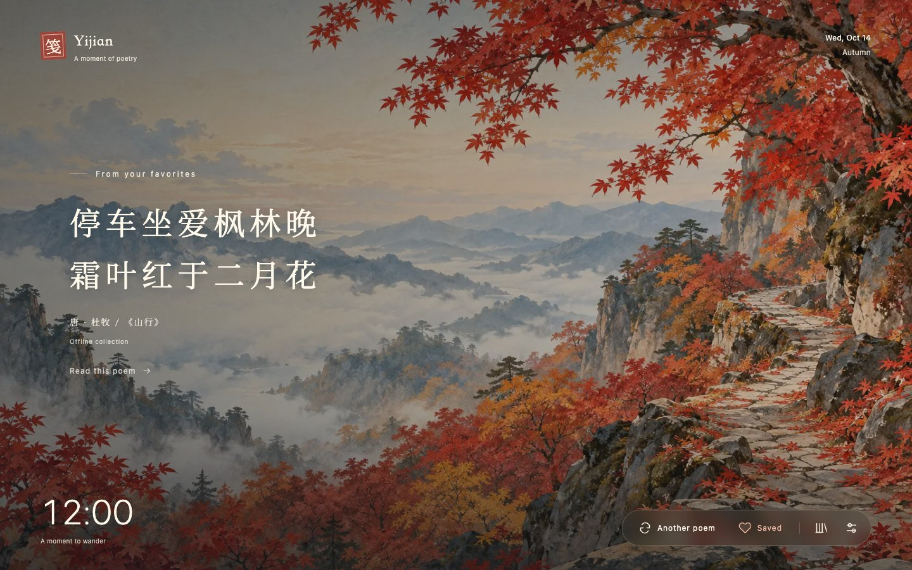

# Yijian · Poetry New Tab

**A moment of poetry.**

Yijian is a Chrome new tab extension that brings classical Chinese poetry, prose, and illustrations into everyday browsing. It includes online recommendations, an offline collection, a lunar calendar, local favorites, and Chinese and English interfaces.

[简体中文](README.md) · [Installation](#installation) · [Development](#development) · [Issues](https://github.com/stevendong/poetry-tab/issues)



## Features

- **Poems for the moment:** Poetry Service provides online recommendations by default. You can also choose Jinrishici or a custom API. When online recommendations are disabled or unavailable, the extension selects from 17 built-in poems and illustrations using the season and time of day.
- **Dedicated illustrations:** Poems with matching artwork display it. Other poems use a default gradient background.
- **Load by ID:** Enter a Poetry Service quotation ID in Settings to display its published poem, original text, commentary and background. Favorites work normally, and your default source stays unchanged.
- **Cached startup:** New tabs first restore the last successfully displayed poem and image. A new poem and its image replace them together once loaded; failures leave the cached display in place. Caches respect source and background settings. Once the current background is visible, other Poetry Service images and video posters preload one at a time at low priority. Preloading stops when online recommendations are disabled and is skipped in data-saving mode.
- **Read further:** Open the original text, explanation or translation, commentary, and source. Missing online translations are clearly indicated.
- **Local favorites:** Saved poems remain readable offline. Favorites and preferences sync between tabs in the same browser profile.
- **Calendar:** Click the date to browse Gregorian and Chinese lunar dates, zodiac years, and solar terms from 1900 to 2100.
- **Simplified Chinese, Traditional Chinese, and English UI:** Choose a language in Settings or follow the browser. Chinese options also switch the script of poems, commentary, favorites, and the calendar. Conversion works entirely offline; preferences save automatically and update open tabs.
- **Reading preferences:** Choose your hemisphere, clock visibility, explanation display, poem font, text size, and background shade. Font choices include Kai (default), serif, and the system font; preferences save automatically and sync across open tabs.

<details>
<summary>Calendar preview (Chinese interface)</summary>


</details>

## Installation

Installing the extension requires neither Node.js nor a build step.

1. [Download the repository ZIP](https://github.com/stevendong/poetry-tab/archive/refs/heads/main.zip) and extract it, or clone the repository:

   ```sh
   git clone https://github.com/stevendong/poetry-tab.git
   ```

2. Open `chrome://extensions` in Chrome.
3. Enable **Developer mode** and click **Load unpacked**.
4. Select the repository's **`extension/` directory**.
5. Open a new tab.

After updating the code, reload the extension on the extensions page and open a new tab. If another new tab extension appears, check your enabled extensions.

If saving an API reports that extension permissions need updating, follow the same reload steps. Refreshing the new tab alone does not update the permission manifest loaded by the browser.

## Usage

| Action                                    | Result                                                |
| ----------------------------------------- | ----------------------------------------------------- |
| Another poem, or `Space` on the main page | Select another poem                                   |
| Heart button                              | Save or remove the current poem                       |
| Read this poem                            | Open the original text, commentary, and source        |
| Favorites button                          | Browse saved poems                                    |
| Date in the upper right                   | Open the calendar                                     |
| Settings button                           | Change the interface language and reading preferences |
| `Esc`                                     | Close an open dropdown first, then the panel          |

In the calendar, use the arrow keys to select dates, `PageUp` / `PageDown` to change months, and `Home` / `End` to move to the first or last day of the week.

Change Settings → Poem font to update poems on the main page, reading panel, and favorites instantly. All options use installed system fonts; no font files are bundled or downloaded. Kai is the default, with a system serif fallback when Kai is unavailable.

With online recommendations enabled, enter the recommendation record's `id` under Settings → Specific quotation ID, then click Load poem or press Enter. The extension reads `/api/v1/quotations/{id}` from the saved Poetry Service API, bypassing seasonal selection and recent-history exclusions. Missing, unpublished or unavailable records leave the current poem unchanged. Next poem and new tabs resume your saved recommendation settings. Use the quotation record's `id`, rather than `workId` or `publicationId`.

The header shows a solar term only on its date. Dates and the clock follow your local time zone. Solar term dates are approximate. Offline seasons begin at the traditional solar terms for spring, summer, autumn, and winter, and reverse in the Southern Hemisphere.

## Data and privacy

- The extension uses `storage` and default host access to the official Poetry Service API and Jinrishici. Other custom sites use optional host permissions, requested for the chosen site when you save its API.
- Online recommendations use Poetry Service at `https://poetry-api.nabulalogic.com` by default. It receives your IP, season, time of day, solar term (Northern Hemisphere), background preference, and recent poem IDs. Poetry Service and custom requests send no cookies or Jinrishici identifiers. If you choose Jinrishici, its anonymous client identifier and recommendation cache are stored locally.
- Turning online recommendations off uses the built-in collection and stops new poem API requests.
- Favorites and settings use `chrome.storage.local`; the web preview uses `localStorage`. They do not sync to other browsers through an account.
- Built-in artwork is bundled, and fonts come from your system. The calendar and saved text work offline. The last successful poem and image are stored locally in IndexedDB so the cached image can be restored offline. If an image host blocks cross-origin reads, only its URL is saved and the browser's image cache is used; videos still require a connection. No account or location permission is required.

## Development

The extension uses plain HTML, CSS, JavaScript ES modules, and Manifest V3. It has no npm runtime dependencies. Development and automated tests require **Node.js 20+ and npm**; use a [current Node.js LTS release](https://nodejs.org/en/download).

```sh
git clone https://github.com/stevendong/poetry-tab.git
cd poetry-tab
npm ci
npm run preview
```

The preview listens on `http://127.0.0.1:4173/` by default. Set `PORT` to choose another port, and use the URL printed in the terminal. The preview uses offline poems; load the extension in Chrome to exercise online recommendations and the extension background worker.

| Command                 | Purpose                                                                    |
| ----------------------- | -------------------------------------------------------------------------- |
| `npm run preview`       | Start the local preview; no development dependencies needed                |
| `npm test`              | Unit tests for seasons, calendar, language, online caching, and favorites  |
| `npm run check`         | Validate the manifest, local resources, scripts, and illustration mappings |
| `npm run test:browser`  | Test the new tab page, offline mode, favorites, and settings               |
| `npm run test:online`   | Test online recommendations, caching, fallback, and saved online poems     |
| `npm run test:background` | Test background loading, preloading, cached startup, and cancellation |
| `npm run test:api-settings` | Test stale manifest guidance, authorization failures, and API settings |
| `npm run test:specified` | Test loading by ID, failure handling, favorites, and late responses |
| `npm run test:calendar` | Test calendar interaction, keyboard controls, and narrow layouts           |
| `npm run test:language` | Test Chinese script and English switching, persistence, tab sync, and layouts |
| `npm run pack`          | Create the extension ZIP, unpacked directory, and SHA-256 checksum         |

### Browser tests

Tests use Playwright with full Chromium. Some test scripts still have a fixed browser path, so set `CHROME_PATH` explicitly. The following example is for macOS / Linux:

```sh
npx playwright install chromium
export CHROME_PATH="$(node --input-type=module -e 'import { chromium } from "playwright"; process.stdout.write(chromium.executablePath());')"
npm run test:browser
npm run test:online
npm run test:calendar
npm run test:language
```

On Linux, use `npx playwright install --with-deps chromium` if system dependencies are missing. See the [Playwright extension testing documentation](https://playwright.dev/docs/chrome-extensions) for browser setup and extension loading.

`test:online` uses simulated API responses by default. Set `LIVE_API=1` to additionally check the real service, which makes network requests:

```sh
LIVE_API=1 npm run test:online
```

Screenshots and test reports are written to `artifacts/`, which is excluded from version control.

### Packaging

```sh
npm run pack
```

Output goes to `dist/`: `poetry-tab/` is the loadable extension directory, `poetry-tab-v<version>.zip` is the archive, and the adjacent `.sha256` file contains its checksum. The `dist/` directory is excluded from version control; generate it after downloading the source.

The ZIP must stay below 1,000,000 bytes or packaging fails. All 17 offline illustrations remain bundled at 640px wide; online images and videos load from their original service URLs. Asset and original-file records are maintained on the [Notion project page](https://www.notion.so/3f92dbec685c81fa87bbf6bf606e2844).

The archive includes the project's MIT license and the MIT / Apache-2.0 licenses for OpenCC code and dictionaries.

### Project structure

```text
extension/             Extension pages, worker, and local assets
  quotes.js            Offline poems, commentary, and sources
  online.js            Online recommendations, cache, and saved snapshots
  context.js           Seasons and offline poem selection
  calendar*.js         Calendar data and interaction
  i18n.js              Simplified/Traditional Chinese and English UI and dates
  chinese.js           Local Chinese script conversion for displayed poems
  vendor/opencc/       OpenCC code, dictionaries, and licenses
  _locales/            Localized Chrome extension name and description
  assets/              Illustrations and icons
scripts/               Preview, validation, and packaging
tests/                 Unit and browser tests
docs/images/           README screenshots
```

## Contributing

Report bugs and suggest improvements through [Issues](https://github.com/stevendong/poetry-tab/issues), or open a pull request. Include the browser version, operating system, reproduction steps, and screenshots, with personal information removed.

Run `npm test` and `npm run check` before submitting a change. For interface or interaction changes, also run the relevant browser tests. Preserve sources and asset provenance when adding poems, translations, or illustrations, and update the related data and tests.

## Sources and license

The project uses the [MIT License](LICENSE). Third-party texts and online service content retain their own licenses and terms.

| Content                               | Source                                                                                                                                                               |
| ------------------------------------- | -------------------------------------------------------------------------------------------------------------------------------------------------------------------- |
| Offline poem originals                | Each entry in [`quotes.js`](extension/quotes.js) links to [Wikisource](https://zh.wikisource.org/)                                                                   |
| Offline explanations and commentary   | Written for this project                                                                                                                                             |
| Online poems and Chinese translations | Provided by the [Jinrishici API](https://www.jinrishici.com/)                                                                                                        |
| Default online poems, media and commentary | Poetry Service recommendations at `https://poetry-api.nabulalogic.com` |
| Chinese script conversion             | [OpenCC JavaScript](https://github.com/nk2028/opencc-js) 1.4.2, bundled locally; see [provenance and licenses](extension/vendor/opencc/README.md) |
| Illustrations                         | AI-assisted artwork; prompts and generation records are in [`prompts.json`](extension/assets/art/prompts.json)                                                       |
| Kai, serif, and sans-serif fonts       | Installed system fonts; no additional font files are distributed |
| English solar term names              | Based on the [Hong Kong Observatory calendar](https://www.hko.gov.hk/en/gts/time/24solarterms.htm)                                                                   |

## Custom poetry APIs (v0.3.0)

In Settings, choose **poetry-service** (pre-filled with `https://poetry-api.nabulalogic.com`) or **Custom JSON API**, enter the address, and click **Save API and connect**. Chrome requests access only to the selected API site. Poetry Service accepts a base URL or the full recommendation endpoint and supplies original works, interpretations, image backgrounds and muted video backgrounds. API failures use the 17 bundled offline poems.

A custom GET endpoint accepts `content` (or `lines`), `title` and `author`, with optional `fullText`, `meaning`, `appreciation`, `imageUrl`, or `videoUrl` + `posterUrl`. Records can be returned directly or under `quote` / `data`. Saved text remains readable offline; remote backgrounds require a connection. Custom requests omit cookies and the Jinrishici client marker. API and media providers receive connection data; Poetry Service also receives season, time of day, background preference, recent poem IDs and solar term (Northern Hemisphere only).

`npm run test:custom` tests the real Chrome host permission prompt, local JSON fixtures, images, video and failure paths. It requires Linux with Xvfb, xdotool, ImageMagick and FFmpeg. Add `LIVE_API=1` to verify the public production Poetry Service and CDN image. Full interface and acceptance records are maintained on the [Notion project page](https://www.notion.so/3f92dbec685c81fa87bbf6bf606e2844).
